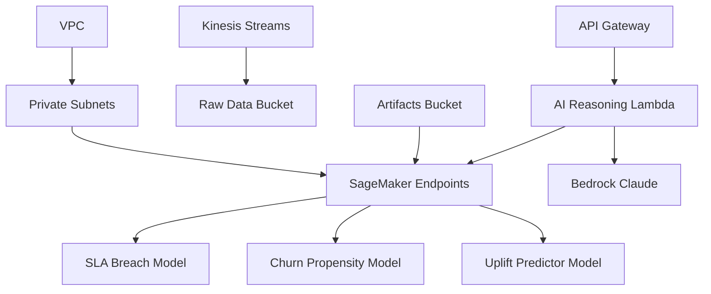

# StratOpsAI

AI-powered strategic operations platform for SLA breach prediction, churn analysis, and uplift modeling.

## Architecture



## Quick Start (Hackathon)

### Prerequisites
- AWS CLI configured with appropriate permissions
- AWS CloudShell or local terminal

### Deploy Infrastructure

1. **Clone and navigate:**
```bash
git clone <repo-url>
cd StratOpsAI
```

2. **Deploy base infrastructure:**
```bash
aws cloudformation deploy \
  --template-file infra/stack1.yaml \
  --stack-name stratopsai-infrastructure \
  --capabilities CAPABILITY_IAM \
  --region us-east-1
```

3. **Upload dummy models:**
```bash
chmod +x scripts/upload_dummy_models.sh
./scripts/upload_dummy_models.sh
```

4. **Deploy AI core:**
```bash
chmod +x scripts/deploy_stack2.sh
./scripts/deploy_stack2.sh
```

### Deploy Frontend (Optional)

```bash
# Setup frontend development
chmod +x scripts/setup-frontend.sh
./scripts/setup-frontend.sh

# Deploy to AWS Amplify (requires GitHub repo)
./scripts/deploy-amplify.sh \
  https://github.com/yourusername/StratOpsAI \
  ghp_your_github_token \
  dev
```

### Test the API

```bash
# Get API endpoint
API_URL=$(aws cloudformation describe-stacks \
  --stack-name stratopsai-ai-core \
  --query 'Stacks[0].Outputs[?OutputKey==`ApiEndpoint`].OutputValue' \
  --output text)

# Test reasoning endpoint
curl -X POST "$API_URL/ai/reasoning" \
  -H "Content-Type: application/json" \
  -d '{"customer_id": "12345", "metrics": {"sla_score": 0.85, "usage_trend": -0.1}}'
```

## Project Structure

```
├── frontend/             # React web application
├── infra/                # CloudFormation templates
├── lambda/               # Lambda function code
├── scripts/              # Deployment scripts
├── config/               # Environment configurations
├── docs/                 # Documentation
├── .github/workflows/    # CI/CD pipelines
└── requirements.txt      # Python dependencies
```

## Development

### Backend
Install dependencies:
```bash
pip install -r requirements.txt
```

Run tests:
```bash
pytest lambda/tests/
```

### Frontend
Setup and run:
```bash
cd frontend
npm install
npm run dev
```

## Environment Variables

See `config/dev.env` and `config/prod.env` for sample configurations.