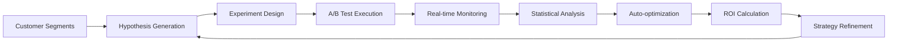

# StratOpsAI System Architecture

## Overview

StratOpsAI is designed as a modern, cloud-native platform that leverages artificial intelligence to provide strategic insights for customer operations. The architecture follows a microservices pattern with clear separation between data ingestion, AI processing, and user interface layers.

## Architecture Diagram

```mermaid
graph TB
    subgraph "Data Sources"
        A[Customer Data] --> B[Support Tickets]
        A --> C[Usage Metrics]
        A --> D[Billing Data]
    end
    
    subgraph "Ingestion Layer"
        B --> E[Kinesis Data Streams]
        C --> E
        D --> E
        E --> F[S3 Raw Data Bucket]
    end
    
    subgraph "AI/ML Layer"
        F --> G[Data Processing Pipeline]
        G --> H[Feature Engineering]
        H --> I[SLA Breach Model]
        H --> J[Churn Prediction Model]
        H --> K[Uplift Prediction Model]
        
        I --> L[SageMaker Endpoints]
        J --> L
        K --> L
    end
    
    subgraph "Reasoning Engine"
        L --> M[AI Reasoning Lambda]
        M --> N[Bedrock Claude]
        N --> O[Strategic Narrative]
        M --> P[Prediction Aggregation]
    end
    
    subgraph "API Layer"
        P --> Q[API Gateway]
        O --> Q
        Q --> R[/ai/reasoning Endpoint]
    end
    
    subgraph "Frontend Layer"
        R --> S[React Application]
        S --> T[AI Reasoning Interface]
        S --> U[ROI Experiments Dashboard]
        S --> V[Strategic Dashboard]
    end
    
    subgraph "Experimentation Engine"
        M --> W[Step Functions]
        W --> X[ROI Experiments]
        X --> Y[A/B Testing Framework]
        Y --> Z[Autonomous Optimization]
    end
    
    style I fill:#e1f5fe
    style J fill:#e1f5fe
    style K fill:#e1f5fe
    style M fill:#f3e5f5
    style N fill:#f3e5f5
    style S fill:#e8f5e8
```

## Component Details

### Data Ingestion Layer

**Kinesis Data Streams**
- Real-time ingestion of customer interaction data
- Scalable to handle high-volume data streams
- Automatic partitioning and load balancing

**S3 Storage**
- Raw data bucket for unprocessed customer data
- Artifacts bucket for ML models and processed data
- Versioning and lifecycle policies for cost optimization

### AI/ML Processing Layer

**SageMaker Models**
1. **SLA Breach Risk Model**
   - Predicts probability of SLA violations
   - Features: response time, ticket volume, customer tier
   - Output: Risk score (0-1) with confidence level

2. **Churn Prediction Model**
   - Analyzes customer behavior patterns
   - Features: usage trends, support interactions, billing history
   - Output: Churn probability with retention recommendations

3. **Uplift Prediction Model**
   - Identifies upsell/cross-sell opportunities
   - Features: product usage, contract value, engagement metrics
   - Output: Uplift potential score and recommended actions

**Model Training Pipeline**
- Automated retraining based on new data
- A/B testing for model performance comparison
- Feature importance analysis and drift detection

### AI Reasoning Engine

**Lambda Function Architecture**
```python
def lambda_handler(event, context):
    # 1. Parse customer data
    customer_data = parse_input(event)
    
    # 2. Invoke SageMaker models
    sla_risk = invoke_sla_model(customer_data)
    churn_risk = invoke_churn_model(customer_data)
    uplift_score = invoke_uplift_model(customer_data)
    
    # 3. Generate strategic narrative
    narrative = generate_narrative_with_bedrock({
        'sla_risk': sla_risk,
        'churn_risk': churn_risk,
        'uplift_score': uplift_score,
        'customer_context': customer_data
    })
    
    # 4. Return comprehensive analysis
    return {
        'predictions': {
            'sla_breach_risk': sla_risk,
            'churn_propensity': churn_risk,
            'uplift_potential': uplift_score
        },
        'narrative': narrative,
        'recommendations': generate_recommendations()
    }
```

**Bedrock Integration**
- Uses Claude 3 Sonnet for narrative generation
- Contextual analysis of prediction results
- Strategic recommendations in natural language

### ROI Experimentation Framework

**Autonomous Experiment Design**


**Step Functions Workflow**
1. **Segment Identification**: AI identifies customer cohorts for testing
2. **Hypothesis Generation**: Automated creation of experiment hypotheses
3. **Test Execution**: Deploy interventions to treatment groups
4. **Performance Monitoring**: Real-time tracking of key metrics
5. **Statistical Analysis**: Bayesian inference for significance testing
6. **Optimization**: Continuous parameter tuning for maximum ROI

### API Architecture

**RESTful Design**
```
POST /ai/reasoning
├── Input: Customer metrics and context
├── Processing: Multi-model inference pipeline
└── Output: Predictions + narrative + recommendations

GET /experiments
├── Output: Active and completed ROI experiments
└── Metrics: Conversion rates, ROI, statistical significance

GET /dashboard/metrics
├── Output: Real-time KPIs and alerts
└── Data: Customer health scores, trend analysis
```

**Error Handling & Resilience**
- Circuit breaker pattern for external service calls
- Graceful degradation when models are unavailable
- Comprehensive logging and monitoring with CloudWatch

### Frontend Architecture

**React Component Hierarchy**
```
App
├── Navbar (Navigation + Dark Mode)
├── Router
│   ├── Home (Landing + Features)
│   ├── AIReasoning (Form + Results)
│   ├── ROIExperiments (Experiment Cards)
│   ├── Dashboard (KPIs + Alerts)
│   └── About (Team + Architecture)
└── Footer (Links + Branding)
```

**State Management**
- Local component state for form data
- Context API for theme management
- Mock data services for demonstration

**Performance Optimizations**
- Code splitting with React Router
- Lazy loading for heavy components
- Optimized bundle size with Vite
- Progressive enhancement for mobile

## Scalability Considerations

### Horizontal Scaling
- **API Gateway**: Automatic scaling for request handling
- **Lambda Functions**: Concurrent execution scaling
- **SageMaker Endpoints**: Auto-scaling based on traffic
- **Kinesis Streams**: Shard-level parallelization

### Vertical Scaling
- **Model Complexity**: Upgrade to larger instance types
- **Memory Allocation**: Configurable Lambda memory
- **Storage Capacity**: S3 unlimited storage with lifecycle policies

### Cost Optimization
- **Serverless Architecture**: Pay-per-use pricing model
- **Spot Instances**: For batch processing workloads
- **Data Lifecycle**: Automated archival of old data
- **Model Optimization**: Quantization and pruning for efficiency

## Security Architecture

### Data Protection
- **Encryption at Rest**: S3 server-side encryption
- **Encryption in Transit**: TLS 1.3 for all communications
- **Access Control**: IAM roles with least privilege principle
- **Data Anonymization**: PII scrubbing in processing pipeline

### Network Security
- **VPC Isolation**: Private subnets for sensitive components
- **Security Groups**: Restrictive firewall rules
- **API Gateway**: Rate limiting and request validation
- **WAF Integration**: Protection against common attacks

### Compliance
- **GDPR Compliance**: Data retention and deletion policies
- **SOC 2 Type II**: Security and availability controls
- **HIPAA Ready**: Healthcare data protection capabilities
- **Audit Logging**: Comprehensive activity tracking

## Monitoring & Observability

### Metrics Collection
- **Application Metrics**: Custom CloudWatch metrics
- **Infrastructure Metrics**: CPU, memory, network utilization
- **Business Metrics**: Prediction accuracy, customer satisfaction
- **Cost Metrics**: Resource utilization and spending analysis

### Alerting Strategy
- **Threshold-based Alerts**: For critical system metrics
- **Anomaly Detection**: ML-powered unusual pattern detection
- **Escalation Policies**: Automated incident response
- **Dashboard Integration**: Real-time status visualization

### Distributed Tracing
- **X-Ray Integration**: End-to-end request tracing
- **Performance Profiling**: Bottleneck identification
- **Error Correlation**: Root cause analysis
- **Dependency Mapping**: Service interaction visualization

This architecture provides a robust, scalable foundation for AI-powered strategic operations while maintaining cost efficiency and operational excellence.